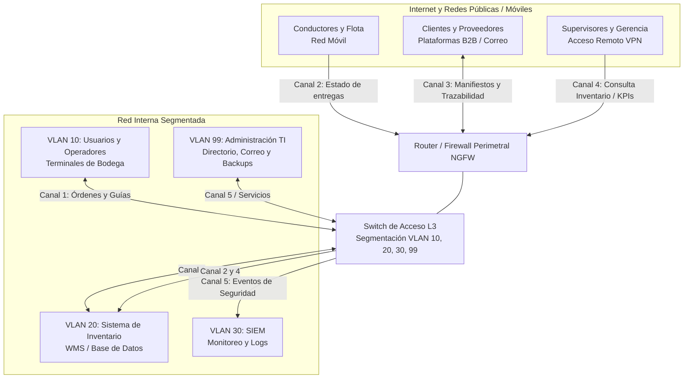

# Informe Técnico: Análisis Criptográfico y Política de Seguridad en Redes
**Caso 2: Empresa Logística (Zona Centro – Región Metropolitana)**

| Metadatos del Documento | Detalle |
| :--- | :--- |
| **Nombre** | Oscar Muñoz Carvajal |
| **Carrera** | Ingeniería en Ciberseguridad |
| **Asignatura** | Seguridad en Redes (`CI3062`) – Unidad 2: Criptografía en redes de datos |
| **Docente Guía** | Rubén Alejandro Schnettler Lucero |
| **Fecha** | 05 de noviembre de 2026 |
| **Versión** | 2.0 (Informe Técnico Ajustado – Evaluación Sumativa) |

---

## Índice de Contenidos
1. [Presentación del Caso y Activos Críticos Protegidos](#1-presentación-del-caso-y-activos-críticos-protegidos)
2. [Síntesis de Canales Críticos y Riesgos Criptográficos Identificados](#2-síntesis-de-canales-críticos-y-riesgos-criptográficos-identificados)
3. [Selección Ajustada de Algoritmos de Cifrado y Funciones Hash](#3-selección-ajustada-de-algoritmos-de-cifrado-y-funciones-hash)
   - [3.1. Ajuste y Selección de Algoritmos de Cifrado Simétrico y Asimétrico (Criterio 2.1.1)](#31-ajuste-y-selección-de-algoritmos-de-cifrado-simétrico-y-asimétrico-criterio-211)
   - [3.2. Ajuste y Selección de Funciones Hash e Integridad de Datos (Criterio 2.1.2)](#32-ajuste-y-selección-de-funciones-hash-e-integridad-de-datos-criterio-212)
4. [Estándares y Normas de Ciberseguridad Aplicables al Caso (Criterio 2.1.3)](#4-estándares-y-normas-de-ciberseguridad-aplicables-al-caso-criterio-213)
5. [Propuesta Preliminar Ajustada de Política de Seguridad en Redes (Criterio 2.1.4)](#5-propuesta-preliminar-ajustada-de-política-de-seguridad-en-redes-criterio-214)
   - [5.1. Matriz de Política de Seguridad Criptográfica en Redes (Tabla 4)](#51-matriz-de-política-de-seguridad-criptográfica-en-redes-tabla-4)
   - [5.2. Parámetros Criptográficos Mínimos y Controles Complementarios de Red](#52-parámetros-criptográficos-mínimos-y-controles-complementarios-de-red)
6. [Conclusión Técnica](#6-conclusión-técnica)
7. [Referencias Bibliográficas](#7-referencias-bibliográficas)

---

## 1. Presentación del Caso y Activos Críticos Protegidos

La empresa logística ubicada en la Región Metropolitana opera un sistema integrado para la gestión de bodegas (WMS), control de despacho y trazabilidad de carga, manteniendo operaciones comerciales con grandes cadenas de retail y operadores de comercio exterior (COMEX). A partir de la intervención realizada en la Unidad 1, la organización dispone de una red segmentada lógicamente mediante un **Switch de acceso Capa 3 (`IOSvL2/L3`)**, filtrado de tráfico en un **Router/Firewall perimetral (`NGFW`)** y monitoreo centralizado de eventos en un servidor **SIEM**.

Si bien las medidas anteriores delimitan el perímetro y segmentan la red en cuatro zonas (**VLAN 10, VLAN 20, VLAN 30 y VLAN 99**), la información operacional y comercial transita sin protección criptográfica. En consecuencia, un adversario interno o externo podría interceptar órdenes de despacho, manipular manifiestos de carga en tránsito o suplantar accesos gerenciales sin ser detectado.

| Activo Crítico Identificado | Ubicación / Segmento | Función Operacional en la Empresa Logística | Requisito Criptográfico Primario |
| :--- | :--- | :--- | :--- |
| **Sistema de inventario y gestión de bodegas (WMS/ERP)** | `VLAN 20` | Base de datos central de inventario, gestión de bodegas y generación de guías de traslado. | Confidencialidad e Integridad en transacciones internas y consultas remotas. |
| **Terminales y PCs operacionales de bodega** | `VLAN 10` | Ingreso de órdenes de despacho, emisión de guías de traslado y consulta de stock. | Confidencialidad de sesión en comunicaciones con `VLAN 20`. |
| **Dispositivos móviles de conductores y flota** | Enlace externo (Red móvil / VPN) | Actualización de estado de entregas, confirmación de carga/descarga y enlace con central. | Confidencialidad de canal, autenticación de dispositivo y eficiencia energética. |
| **Plataformas B2B y Correo Corporativo con terceros** | Intercambio externo / `VLAN 99` | Intercambio de manifiestos de carga, documentos de trazabilidad y órdenes con clientes y proveedores. | Confidencialidad, Integridad documental y No Repudio (Firma Digital). |
| **Accesos remotos de Supervisores y Gerencia** | Red pública $\rightarrow$ NGFW | Consulta remota de inventario e indicadores operacionales (KPIs) desde fuera de la planta. | Autenticación mutua robusta (Certificados Digitales X.509) y cifrado de túnel VPN. |
| **SIEM – Monitoreo de seguridad** | `VLAN 30` | Recepción de eventos de seguridad, correlación, generación de alertas y reportes de incidentes. | Integridad forense de bitácoras, autenticidad de origen y confidencialidad en tránsito. |
| **Servidores corporativos, Directorio y Backups** | `VLAN 99` / Otros | Servicios de Directorio/Autenticación, correo interno, aplicaciones y copias de respaldo. | Protección irreversible de credenciales (KDF) e integridad de archivos de backup. |

---

## 2. Síntesis de Canales Críticos y Riesgos Criptográficos Identificados

A partir del modelo arquitectónico del caso (Figura 1), se identifican **cinco canales críticos de comunicación** expuestos a riesgos de interceptación (*sniffing*), intermediación (*Man-in-the-Middle*), falsificación documental y compromiso de credenciales:

1. **Canal 1 – Órdenes de despacho y guías de traslado (`VLAN 20` Sistema de Inventario $\leftrightarrow$ `VLAN 10` Terminales de Bodega):**
   * **Problema detectado:** Transmisión interna en texto plano dentro de la red corporativa.
   * **Riesgo criptográfico:** Pérdida de **confidencialidad** por interceptación local (*packet sniffing* o ARP spoofing), exponiendo el detalle de mercadería crítica y rutas internas.
2. **Canal 2 – Actualizaciones de estado de entregas (`Conductores en Red Móvil` $\leftrightarrow$ `NGFW` $\leftrightarrow$ `VLAN 20`):**
   * **Problema detectado:** Comunicaciones operacionales sobre redes celulares públicas con configuración criptográfica no estandarizada.
   * **Riesgo criptográfico:** Exposición a ataques *Man-in-the-Middle* (MitM), escucha no autorizada y suplantación de terminales de transporte.
3. **Canal 3 – Intercambio B2B de manifiestos de carga y documentos de trazabilidad (`VLAN 99` $\leftrightarrow$ `Clientes y Proveedores externos`):**
   * **Problema detectado:** Envío de documentos mediante correo corporativo y plataformas B2B sin cifrado de extremo a extremo, funciones hash ni firma digital.
   * **Riesgo criptográfico:** Pérdida de **confidencialidad**, **integridad documental** y **no repudio**; un tercero podría modificar cantidades, destinatarios o sellos de trazabilidad sin que la empresa pueda detectarlo.
4. **Canal 4 – Accesos remotos de supervisores y gerencia (`Internet` $\leftrightarrow$ `NGFW` $\leftrightarrow$ `VLAN 20 / VLAN 99`):**
   * **Problema detectado:** Consultas remotas al inventario e indicadores operacionales sin certificados digitales para autenticar la identidad de los supervisores ni cifrado asimétrico robusto en el intercambio de claves.
   * **Riesgo criptográfico:** Suplantación de identidad ejecutiva, robo de credenciales y acceso no autorizado a sistemas *core* desde redes públicas.
5. **Canal 5 – Recolección de eventos de seguridad (`Switch L3 / Servidores VLAN 99` $\leftrightarrow$ `SIEM en VLAN 30`):**
   * **Problema detectado:** Envío de registros de eventos y alertas de seguridad sin protección criptográfica de canal ni validación de integridad de origen.
   * **Riesgo criptográfico:** Un atacante que comprometa un segmento podría leer las alertas generadas o inyectar/modificar bitácoras para ocultar evidencias forenses.

---

## 3. Selección Ajustada de Algoritmos de Cifrado y Funciones Hash

### 3.1. Ajuste y Selección de Algoritmos de Cifrado Simétrico y Asimétrico (Criterio 2.1.1)

En cumplimiento del **Paso 1** de la guía de evaluación, la **Tabla 1** documenta las correcciones y mejoras técnicas incorporadas respecto del informe formativo previo:

#### Tabla 1. Selección de algoritmos de cifrado según canales críticos (Registro de ajustes)

| Aspecto corregido | Observación recibida (Revisión técnica formativa) | Ajuste incorporado en el informe | Evidencia o sección ajustada |
| :--- | :--- | :--- | :--- |
| **Canal crítico** | El informe formativo analizaba únicamente 4 canales, omitiendo el flujo 5 definido en el diagrama arquitectónico (recolección de eventos de seguridad hacia el SIEM en la VLAN 30). | Se incorpora el **Canal 5 (Eventos de seguridad hacia SIEM – VLAN 30)** mediante transporte cifrado Syslog sobre TLS 1.3. | Sección 2 y Matriz de Cifrado (Sección 3.1, Fila 5). |
| **Datos transmitidos** | En el Canal 3 (Intercambio B2B) no se diferenciaba la protección del canal de comunicación web respecto de la protección de los archivos y manifiestos adjuntos enviados por correo. | Se distingue la protección de transporte (**TLS 1.3** para portales/APIs B2B) respecto del cifrado y firma de documentos/correos (**S/MIME / OpenPGP**). | Sección 3.1, Fila 3 de la Matriz de Cifrado. |
| **Activo o sistema involucrado** | Se mencionaban los sistemas de forma general sin especificar en todos los casos la interacción con el Switch L3, el NGFW perimetral y los servidores de la VLAN 99. | Se mapea cada canal con sus activos exactos y VLANs correspondientes (`VLAN 10`, `VLAN 20`, `VLAN 30`, `VLAN 99` y `NGFW`). | Sección 1 y Sección 3.1 (Columna Activo o sistema involucrado). |
| **Nivel de confidencialidad** | El Canal 1 (Tráfico interno LAN entre VLAN 20 y VLAN 10) fue calificado con nivel "Medio", subestimando el impacto operacional del robo de guías de despacho dentro de la bodega. | Se recalifica el nivel de confidencialidad del Canal 1 a **Alto (Datos operacionales críticos)** bajo el principio de cero confianza en la red interna (*Zero Trust*). | Sección 3.1, Fila 1 de la Matriz de Cifrado. |
| **Algoritmo o mecanismo de cifrado** | En el Canal 1 se proponía `RSA-2048` para el *handshake* TLS (obsoleto en TLS 1.3 por carecer de *Forward Secrecy*) y en el Canal 4 se indicaba `AES-256-CBC/GCM`. | Se reemplaza RSA en el intercambio de claves por **ECDHE** (garantizando *Perfect Forward Secrecy*) y se elimina el modo `CBC`, estandarizando exclusivamente el modo autenticado **AES-256-GCM**. | Sección 3.1 (Matriz de Cifrado) y Sección 5.2 (Parámetros criptográficos). |

#### Matriz Actualizada de Selección de Algoritmos de Cifrado Simétrico y Asimétrico

| Canal de comunicación crítico | Datos transmitidos | Activo o sistema involucrado | Nivel de confidencialidad requerido | Algoritmo simétrico seleccionado | Algoritmo asimétrico seleccionado | Justificación técnica de la selección |
| :--- | :--- | :--- | :--- | :--- | :--- | :--- |
| **1. Tráfico interno LAN (Canal 1)** | Órdenes de despacho, consultas de inventario y emisión de guías de traslado. | Sistema de inventario WMS (`VLAN 20`) y Terminales operacionales de bodega (`VLAN 10`). | **Alto** (Protección ante intercepción interna en capa 2/3). | **AES-256-GCM** (sobre protocolo **TLS 1.3**). | **ECDHE (X25519)** para acuerdo de claves + **ECDSA P-256** para autenticación del servidor WMS. | **AES-256-GCM** proporciona cifrado autenticado (AEAD) de alta velocidad utilizando instrucciones de hardware (AES-NI) en los equipos de bodega. **ECDHE** asegura *Perfect Forward Secrecy* (PFS) con mínima latencia en la LAN. |
| **2. Enlace móvil a Central (Canal 2)** | Actualización del estado de entregas y confirmación de carga/descarga en ruta. | Dispositivos móviles de conductores (Red móvil pública) y Router/Firewall perimetral (**NGFW** $\rightarrow$ `VLAN 20`). | **Alto** (Comunicaciones expuestas en redes móviles públicas). | **ChaCha20-Poly1305** (sobre **TLS 1.3** o túnel **VPN IPsec IKEv2**). | **ECDHE (X25519)** + **ECDSA P-256** (certificados en dispositivos móviles). | **ChaCha20-Poly1305** ofrece alto rendimiento por software y menor consumo de batería en procesadores móviles ARM que carecen de aceleración AES por hardware. **ECDHE** mantiene sesiones seguras ante cambios de celda móvil. |
| **3. Intercambio externo B2B y Correo (Canal 3)** | Manifiestos de carga, documentos de trazabilidad, órdenes y confirmaciones. | Servidores de correo y aplicaciones (`VLAN 99`), plataformas B2B de clientes y proveedores externos. | **Crítico** (Datos comerciales, aduaneros y legales sujetos a auditoría de retail y COMEX). | **AES-256-GCM** (en sesiones B2B TLS 1.3 y cifrado de documentos vía **S/MIME o PGP**). | **RSA-4096** (firma digital y cifrado de clave de sesión documental) + **ECDHE** en portales B2B. | Esquema híbrido: **AES-256-GCM** cifra de forma eficiente el volumen del manifiesto de carga, mientras que **RSA-4096** asegura interoperabilidad universal con socios externos para firmas digitales con validez de no repudio. |
| **4. Accesos remotos de Supervisores y Gerencia (Canal 4)** | Consulta de estado de inventario e indicadores operacionales (KPIs). | Equipos remotos de supervisores/gerencia, concentrador VPN en **NGFW** y servidores (`VLAN 20 / VLAN 99`). | **Crítico** (Acceso externo privilegiado hacia sistemas centrales). | **AES-256-GCM** (en túnel **VPN IPsec IKEv2** o **TLS 1.3 mTLS**). | **ECDSA P-384** mediante **Certificados Digitales X.509 v3** + **ECDHE P-384**. | Se descarta el modo CBC por vulnerabilidad a ataques de oráculo de *padding*, utilizando únicamente **AES-256-GCM**. Los certificados **X.509** con **ECDSA** resuelven la ausencia de autenticación fuerte de supervisores señalada en el caso. |
| **5. Eventos de seguridad y monitoreo (Canal 5)** | Registros de eventos (logs), alertas de seguridad, correlación y respaldos. | Switch de acceso L3, servidores corporativos (`VLAN 99`), NGFW y servidor **SIEM (`VLAN 30`)**. | **Alto** (Información crítica sobre incidentes y postura de seguridad de la red). | **AES-256-GCM** (sobre **Syslog-TLS RFC 5425**). | **ECDSA P-256** + **ECDHE** (autenticación mutua entre nodos emisores y SIEM). | Evita que un atacante interno intercepte las alertas enviadas hacia la `VLAN 30` o inyecte eventos falsos desde dispositivos no autorizados. |

---

### 3.2. Ajuste y Selección de Funciones Hash e Integridad de Datos (Criterio 2.1.2)

Atendiendo al **Paso 2** de la guía y a la nota técnica obligatoria para el **Caso 2 (Logística)**, el diseño criptográfico separa estrictamente dos familias de funciones según su propósito operacional:
* **Verificación de integridad documental y de registros (`SHA-256` / `SHA-512` y `HMAC-SHA256`):** Algoritmos de resumen criptográfico de alta velocidad que permiten detectar cualquier alteración de bits en manifiestos de carga, guías de traslado, bitácoras del SIEM y archivos de respaldo.
* **Almacenamiento seguro de credenciales de acceso remoto (`Argon2id` / `bcrypt`):** Funciones de derivación de claves (**KDF**) con *salt* aleatorio único e intensivas en uso de memoria RAM (*memory-hard*), diseñadas para neutralizar ataques de fuerza bruta con hardware dedicado (GPU/ASIC) en caso de filtración del servidor de directorio (`VLAN 99`).

#### Tabla 2. Ajuste y selección de funciones hash según datos que requieren integridad

| Dato, registro o documento a proteger | Activo o sistema asociado | Riesgo de alteración identificado | Función hash seleccionada | Alternativa comparada | Ajuste incorporado en el informe | Justificación técnica de la selección |
| :--- | :--- | :--- | :--- | :--- | :--- | :--- |
| **1. Manifiestos de carga, guías de despacho y documentos de trazabilidad B2B** | Plataformas B2B externas, servidor de correo (`VLAN 99`) y sistema WMS (`VLAN 20`). | Modificación maliciosa de cantidades de carga, destinatarios, rutas o fechas durante el tránsito o almacenamiento, afectando la trazabilidad frente a clientes. | **SHA-256** (256 bits) / **SHA-512** integrado en **Firma Digital** (`RSA-4096`). | **MD5** (128 bits) y **SHA-1** (160 bits) – *Descartados por colisiones demostradas*. | Se vincula el cálculo del resumen **SHA-256** directamente con el proceso de firma digital asimétrica en el Canal 3 para garantizar integridad y autenticidad simultáneamente. | **SHA-256** ofrece resistencia criptográfica a colisiones ($2^{128}$ operaciones) y segunda preimagen. Si un tercero altera un carácter del manifiesto de carga, el hash cambia radicalmente invalidando la firma digital. |
| **2. Credenciales de acceso remoto (Supervisores, Gerencia y Operadores)** | Servidor de Directorio / Autenticación (`VLAN 99`) y concentrador VPN en NGFW. | Compromiso de la base de datos de autenticación y ejecución de ataques *offline* de diccionario, fuerza bruta o tablas precomputadas (*Rainbow Tables*). | **Argon2id** (con *salt* criptográfico único de 128 bits por credencial). | **SHA-256 simple** (*Descartado por ser extremadamente rápido de vulnerar con GPU*) y **bcrypt** (*Evaluado como alternativa secundaria*). | Se incorpora la distinción explícita exigida en la guía para el Caso 2 entre funciones hash documentales y **funciones de derivación de claves (KDF)**, precisando la variante híbrida **Argon2id**. | A diferencia de un hash rápido como SHA-256, **Argon2id** exige un alto costo configurable de memoria RAM y ciclos de CPU, haciendo inviable el craqueo masivo con tarjetas gráficas (GPU/ASIC) y protegiendo contra ataques de canal lateral. |
| **3. Registros de eventos de seguridad (Logs) y Respaldos (Backups)** | Servidor **SIEM (`VLAN 30`)** y Servidor de Backups y Archivos (`VLAN 99`). | Alteración, borrado o falsificación de bitácoras por un intruso para ocultar su actividad en la red, o modificación no detectada de copias de respaldo. | **HMAC-SHA256** (para logs enviados al SIEM) y **SHA-256** (para verificación de archivos de backup). | **SHA-256 simple sin clave** (*Descartado para logs en tránsito porque un atacante podría modificar el log y recalcular su hash*). | Se amplía el alcance del punto 3 para cubrir también los **Backups de la VLAN 99** y se detalla el rol de la llave secreta compartida en la construcción **HMAC-SHA256**. | **HMAC-SHA256** combina la función hash con una clave criptográfica secreta conocida solo por el nodo emisor y el SIEM (`VLAN 30`), asegurando tanto la **integridad del registro** como la **autenticidad de su origen**. |

---

## 4. Estándares y Normas de Ciberseguridad Aplicables al Caso (Criterio 2.1.3)

En conformidad con el **Paso 3** de la guía, las decisiones criptográficas adoptadas para la empresa logística se respaldan en los tres referentes mínimos obligatorios de la unidad (**ISO/IEC 27001**, **ISO/IEC 27002** y **NIST CSF / CIS Controls**), incorporando además normativa complementaria aplicable a la cadena de suministro logística y gestión criptográfica (**ISO 28000** y **NIST SP 800-57 / SP 800-63B**).

#### Tabla 3. Ajuste e identificación de estándares y normas aplicables al caso

| Estándar o norma | Tipo de referente | Activo, canal o riesgo del caso asociado | Lineamiento criptográfico o de seguridad relacionado | Aplicación en la política de seguridad en redes | Ajuste incorporado o sección corregida del informe |
| :--- | :--- | :--- | :--- | :--- | :--- |
| **ISO/IEC 27001:2022** | Mínimo de la unidad | Sistema de inventario (`VLAN 20`), intercambio B2B con terceros (Canal 3), accesos remotos (Canal 4) e inexistencia de una política formal de criptografía en la empresa. | **Anexo A.8.24 (Uso de la criptografía):** Definición e implementación de reglas para el uso eficaz de criptografía y gestión de claves. **Anexo A.5.14 (Transferencia de información):** Controles para proteger datos en tránsito interno y externo. | Sustenta la gobernanza de la política, obligando a declarar formalmente los algoritmos autorizados, el ciclo de vida de llaves criptográficas y los acuerdos de transferencia segura con clientes de retail y COMEX. | Se actualiza la referencia del informe formativo (`Anexo A.10` de la versión 2013) a la nomenclatura vigente **ISO/IEC 27001:2022 (`Controles A.8.24` y `A.5.14`)**, alineada con la bibliografía de la unidad. |
| **ISO/IEC 27002:2022** | Mínimo de la unidad | Servidor de autenticación (`VLAN 99`), terminales de bodega (`VLAN 10`) y ausencia de certificados digitales en accesos remotos de supervisores (Canal 4). | **Control 8.24 (Directrices de implementación criptográfica):** Criterios técnicos para selección de algoritmos, protección de claves privadas, certificados digitales PKI y verificación de integridad. **Control 5.17 / 8.5:** Gestión de información de autenticación secreta. | Respalda directamente la obligación operativa de implementar **Certificados Digitales X.509** para supervisores, cifrado **AES-256-GCM** en enlaces y almacenamiento de contraseñas mediante **Argon2id**. | Se precisa la relación del estándar con la gestión operativa de certificados digitales (emisión, rotación y revocación mediante CRL/OCSP) y la protección de claves privadas en la Sección 4 y Tabla 4. |
| **NIST Cybersecurity Framework (CSF 2.0) / CIS Controls v8** | Mínimo de la unidad | Flujos de datos en tránsito (Canales 1 al 5), flota móvil de conductores (Canal 2), monitoreo en SIEM (`VLAN 30`) y firewall perimetral (**NGFW**). | **NIST CSF `PR.DS-02`** (Seguridad de datos en tránsito) y **`PR.AA`** (Gestión de identidad, autenticación y control de acceso). **CIS Control 3 (3.10)** (Cifrar datos sensibles en tránsito), **CIS Control 6** (MFA/Accesos) y **CIS Control 8** (Gestión de logs de auditoría). | Fundamenta la integración entre los mecanismos criptográficos (**TLS 1.3, IPsec IKEv2, HMAC-SHA256**) y los controles complementarios de red (**NGFW, VPN, IPS/IDS y SIEM**). | Se detallan los controles específicos (`PR.DS-02`, `CIS 3.10` y `CIS 8`) vinculándolos explícitamente con los 5 canales del mapa arquitectónico del caso. |
| **ISO 28000:2022 + NIST SP 800-57 / SP 800-63B** | Complementario (Sectorial Logístico y Criptográfico) | Trazabilidad documental de carga con operadores de comercio exterior (Canal 3) y robustez de parámetros criptográficos y credenciales remotas (Canal 4). | **ISO 28000:** Aseguramiento e integridad verificable en la cadena de suministro logística. **NIST SP 800-57:** Longitudes mínimas de clave criptográfica. **NIST SP 800-63B:** Requisitos para funciones KDF con *salt* y memoria dura (`Argon2id`). | Establece las longitudes mínimas de clave exigidas en la política (`AES-256`, `RSA-4096`, `ECDSA P-384`) y respalda la firma digital obligatoria de manifiestos de carga para cumplir con auditorías de comercio exterior. | Se añade esta **cuarta fila obligatoria de la Tabla 3** (omitida en el avance formativo) para incorporar el referente complementario aplicable al sector logístico. |

---

## 5. Propuesta Preliminar Ajustada de Política de Seguridad en Redes (Criterio 2.1.4)

En respuesta al **Paso 4** de la guía, se establece la propuesta preliminar ajustada de política de seguridad en redes para la empresa logística, integrando los mecanismos criptográficos seleccionados, los estándares de respaldo y los controles de red implementados en la Unidad 1.

### 5.1. Matriz de Política de Seguridad Criptográfica en Redes (Tabla 4)

#### Tabla 4. Propuesta preliminar ajustada de política de seguridad en redes

| Apartado de la política | Decisión o lineamiento propuesto | Mecanismo criptográfico asociado | Control complementario de red | Estándar o norma de respaldo | Ajuste incorporado o sección corregida del informe | Justificación técnica |
| :--- | :--- | :--- | :--- | :--- | :--- | :--- |
| **Propósito y alcance de la política** | Establecer el uso obligatorio de criptografía para proteger la confidencialidad, integridad y autenticidad de las comunicaciones internas (`VLAN 10, 20, 30, 99`), enlaces móviles de conductores, accesos remotos de supervisión e intercambio documental B2B. | Suite criptográfica autorizada (**TLS 1.3, IPsec IKEv2, S/MIME, SHA-256, HMAC-SHA256, Argon2id**). | Segmentación por VLAN en **Switch L3** y control perimetral en **NGFW**. | **ISO/IEC 27001:2022** (`Anexo A.8.24` y `A.5.14`). | Se reemplaza el valor `"N/A"` del informe formativo especificando la suite criptográfica institucional y cubriendo formalmente los 5 canales del caso. | Subsana la ausencia de una política formal de criptografía en la organización y alinea la seguridad lógica con los requerimientos comerciales de retail y COMEX. |
| **Protección de canales críticos** | Queda prohibida la transmisión de datos operacionales, credenciales o documentos en texto plano (HTTP, FTP, Telnet, SMTP sin cifrar) en los Canales 1 al 5. Toda sesión debe negociar cifrado con *Perfect Forward Secrecy* (PFS). | **TLS 1.3** (Canales 1, 3 y 5) e **IPsec IKEv2 / TLS VPN** (Canales 2 y 4) con acuerdo de claves **ECDHE**. | Filtrado de tráfico y bloqueo de protocolos inseguros mediante ACLs en **Switch L3** y reglas de **NGFW**. | **CIS Controls v8** (`Control 3.10`) y **NIST CSF 2.0** (`PR.DS-02`). | Se amplía el lineamiento (que antes solo mencionaba tráfico externo) para obligar a cifrar también el **Canal 1 (LAN interna Bodega-Inventario)** y el **Canal 5 (SIEM)**. | Previene la captura de órdenes de despacho por *sniffing* en la red local de bodega y bloquea interceptaciones *Man-in-the-Middle* en enlaces móviles y públicos. |
| **Uso de cifrado simétrico y asimétrico** | Se exige cifrado simétrico autenticado (AEAD) para el transporte y almacenamiento de datos, y cifrado asimétrico para intercambio de claves efímeras, autenticación y firmas digitales, prohibiendo algoritmos débiles (`DES, 3DES, RC4`) y modos sin autenticación (`ECB, CBC`). | **AES-256-GCM** y **ChaCha20-Poly1305** (simétrico); **ECDHE**, **ECDSA (P-256/P-384)** y **RSA-4096** (asimétrico). | Terminación e inspección de túneles en **NGFW** y seguridad de capa 2/3 en **Switch L3**. | **ISO/IEC 27002:2022** (`Control 8.24`) y **NIST SP 800-57**. | Se elimina el valor `"N/A"` en controles de red y se suprime el modo `CBC` en la VPN, dejando exclusivamente modos autenticados (`GCM` y `Poly1305`). | Asegura máximo rendimiento en servidores WMS (`AES-256-GCM`), eficiencia en dispositivos móviles de la flota (`ChaCha20-Poly1305`) y firmas digitales robustas (`RSA-4096`). |
| **Uso de funciones hash e integridad de datos** | Todo manifiesto de carga, guía de traslado y documento de trazabilidad intercambiado con terceros debe llevar resumen criptográfico y firma digital. Las credenciales de usuarios remotos e internos deben almacenarse únicamente mediante funciones KDF con *salt*. | **SHA-256 / SHA-512** (documentos B2B y backups); **Argon2id** con *salt* de 128 bits (credenciales); **HMAC-SHA256** (bitácoras SIEM). | Resguardo del servidor de directorio/backups en **`VLAN 99`** mediante ACLs y monitoreo de integridad en **SIEM (`VLAN 30`)**. | **ISO/IEC 27002:2022** (`Control 8.24`), **ISO 28000** y **NIST SP 800-63B**. | Se completa la columna de control complementario de red (antes `"N/A"`) vinculándola con la protección de la `VLAN 99` y la auditoría en la `VLAN 30`, especificando **Argon2id**. | Garantiza la detección inmediata de alteraciones en manifiestos de carga B2B y protege las contraseñas de supervisores frente a ataques de fuerza bruta con GPU. |
| **Certificados digitales y gestión de claves** | Despliegue de una Infraestructura de Clave Pública (**PKI**) para emitir certificados digitales a supervisores, gerencia, flota móvil y servidores, exigiendo validación de revocación y resguardo seguro de llaves privadas. | **Certificados X.509 v3** (`ECDSA P-384` para VPN / `RSA-4096` para B2B) y validación en línea vía **OCSP / CRL**. | Validación obligatoria de certificados en el concentrador VPN del **NGFW** y servidor de autenticación en **`VLAN 99`**. | **ISO/IEC 27001:2022** (`Anexo A.8.24`) y **NIST SP 800-57**. | Se incorpora el control complementario en el **NGFW / Directorio VLAN 99** (antes `"N/A"`) y se añade la verificación de revocación por **OCSP/CRL**. | Cierra directamente la vulnerabilidad crítica del caso donde los supervisores accedían remotamente al inventario sin certificados digitales que acreditaran su identidad. |
| **Accesos remotos seguros** | El acceso remoto de supervisores y gerencia al sistema de inventario (`VLAN 20`) e indicadores solo se permitirá a través de túneles VPN con autenticación mutua (certificado X.509 + credencial verificada con Argon2id y MFA). | **VPN IPsec (IKEv2)** o **TLS 1.3 (mTLS)** con **AES-256-GCM**, **ECDHE** y **Certificados X.509 (ECDSA P-384)**. | **VPN / Firewall Perimetral (NGFW)** con filtrado estricto hacia `VLAN 20` y `VLAN 99`. | **NIST CSF 2.0** (`PR.AA` y `PR.DS`) y **CIS Control 6**. | Se precisa el protocolo **IPsec IKEv2** con autenticación mutua por certificado digital X.509 y MFA antes de autorizar el paso hacia la `VLAN 20`. | Impide que un atacante externo acceda a la base de datos de inventario desde Internet incluso si llegara a conocer la contraseña de un supervisor. |
| **Monitoreo, alertas y detección de incidentes** | Todos los eventos de accesos remotos, fallos de validación de certificados, errores de *handshake* TLS/VPN y verificaciones de integridad de manifiestos deben transmitirse cifrados y autenticados hacia el SIEM. | **HMAC-SHA256** (integridad y autenticidad de origen del log) sobre transporte **Syslog-TLS 1.3 (AES-256-GCM)**. | **IPS/IDS** perimetral e interno y correlación centralizada en **SIEM (`VLAN 30`)**. | **CIS Controls v8** (`Control 8` y `Control 13`) e **ISO/IEC 27002:2022** (`Control 8.15`). | Se complementa el uso de **HMAC-SHA256** con el cifrado del **Canal 5 (Syslog-TLS)** para proteger tanto la integridad como la confidencialidad de los eventos hacia la `VLAN 30`. | Asegura trazabilidad forense inalterable ante auditorías e incidentes y permite al IPS/SIEM bloquear ataques de intrusión o manipulación documental en tiempo real. |
| **Mantención y revisión periódica de la política** | Revisión anual de la política criptográfica, rotación programada de certificados y claves, revocación inmediata ante compromiso de dispositivos móviles o portátiles y auditoría semestral de integridad de respaldos. | Renovación anual de certificados **X.509**, rotación de llaves **HMAC/AES** y actualización de parámetros de costo en **Argon2id**. | **Monitoreo / actualización de reglas** en NGFW, firmas de IPS/IDS y listas de suites criptográficas permitidas. | **ISO/IEC 27001:2022** (`Mejora continua` y `Anexo A.8.24`). | Se establecen frecuencias concretas de rotación de llaves, revocación de certificados de flota/supervisores y pruebas de integridad de backups en la `VLAN 99`. | Evita la obsolescencia criptográfica y asegura la continuidad operacional de la empresa logística frente a nuevas vulnerabilidades o exigencias regulatorias. |

---

### 5.2. Parámetros Criptográficos Mínimos y Controles Complementarios de Red

Para garantizar la aplicación efectiva de la política sobre la topología existente de la empresa (sin requerir modificaciones estructurales físicas), se definen los siguientes lineamientos técnicos:

#### A. Longitudes Mínimas de Clave y Condiciones Operativas (Requerimiento del Caso 2)
* **Algoritmos Simétricos:** Longitud mínima obligatoria de **256 bits** (`AES-256-GCM` y `ChaCha20-Poly1305`).
* **Algoritmos Asimétricos basados en Curvas Elípticas (ECC):** Mínimo **256 bits** (`ECDSA P-256` / `Curve25519`) para sesiones internas y móviles, y **384 bits** (`ECDSA P-384`) para certificados de acceso remoto de supervisores y gerencia.
* **Algoritmos Asimétricos basados en RSA:** Mínimo **3072 bits** para propósitos generales y **4096 bits** (`RSA-4096`) para firmas digitales de manifiestos de carga B2B y certificados de la Autoridad Certificadora (CA).
* **Funciones Hash y Derivación de Claves (KDF):** Mínimo **256 bits** de resumen para integridad documental y de bitácoras (`SHA-256`, `SHA-512`, `HMAC-SHA256`). Para el almacenamiento de contraseñas con **Argon2id**, se exige un *salt* único de **128 bits**, costo de memoria mínimo de **64 MiB** y **3 iteraciones**.
* **Ciclo de Vida y Rotación:** Vigencia máxima de **1 año** para certificados digitales X.509 de usuarios y servidores; renegociación automática de claves efímeras (`ECDHE`) en cada sesión TLS 1.3 o cada **60 minutos** en túneles VPN IPsec IKEv2.

#### B. Articulación con los Controles Complementarios de Red
* **Firewall Perimetral (NGFW):** Concentra y valida los túneles **VPN IPsec IKEv2** de supervisores (Canal 4) y conductores (Canal 2), exigiendo certificados digitales **X.509** válidos antes de autorizar el paso hacia la red interna. Adicionalmente, filtra el tráfico B2B (Canal 3) permitiendo únicamente sesiones **TLS 1.3**.
* **Switch de Acceso Capa 3 (`IOSvL2/L3`):** Refuerza la segmentación entre las **VLANs 10, 20, 30 y 99** mediante listas de control de acceso (ACLs) y seguridad de puertos, permitiendo que las terminales de bodega (`VLAN 10`) se comuniquen con el servidor WMS (`VLAN 20`) exclusivamente mediante sesiones cifradas con **TLS 1.3 (`AES-256-GCM`)**.
* **IPS/IDS (Prevención y Detección de Intrusiones):** Analiza el tráfico que atraviesa el perímetro (posterior a la validación del túnel criptográfico) y los enlaces inter-VLAN para detectar firmas de ataques de inyección, fuerza bruta o movimientos laterales hacia los servidores corporativos (`VLAN 99`) y de inventario (`VLAN 20`).
* **SIEM (`VLAN 30`) y Monitoreo Continuo:** Recibe de forma centralizada todos los eventos de seguridad a través del **Canal 5 (`Syslog-TLS`)** y comprueba criptográficamente el código **HMAC-SHA256** de cada registro, emitiendo alertas críticas ante intentos de acceso remoto con certificados revocados o fallos de verificación de integridad en documentos B2B.

---

## 6. Conclusión Técnica

El análisis criptográfico desarrollado para la empresa logística de la Región Metropolitana evidencia que la segmentación de red en VLANs y el filtrado perimetral implementados en la Unidad 1 deben complementarse obligatoriamente con controles criptográficos de extremo a extremo para resguardar los activos de información del negocio.

Las decisiones técnicas consolidadas en este informe responden de manera directa y fundamentada a cada brecha identificada en el caso asignado:
1. **Protección de la confidencialidad según la naturaleza de cada canal:** La elección de **AES-256-GCM** sobre **TLS 1.3** e **IPsec IKEv2** protege eficientemente el alto volumen de órdenes de despacho en la LAN (`VLAN 10` $\leftrightarrow$ `VLAN 20`), las consultas remotas gerenciales (Canal 4) y la recolección de eventos hacia el SIEM (`VLAN 30`, Canal 5). Paralelamente, la incorporación de **ChaCha20-Poly1305** junto con **ECDHE** en el Canal 2 asegura las comunicaciones móviles de la flota de conductores sin penalizar el rendimiento ni la batería de sus terminales, mientras que el uso de **Certificados Digitales X.509 (`ECDSA P-384`)** elimina el riesgo de accesos remotos sin autenticación fuerte.
2. **Garantía de integridad documental, trazabilidad y resguardo de credenciales:** La separación técnica entre **SHA-256** con firma digital **RSA-4096** (para validar la integridad y el no repudio de manifiestos de carga intercambiados con clientes B2B), **HMAC-SHA256** (para asegurar la autenticidad e inalterabilidad forense de las bitácoras del SIEM) y la función de derivación de claves **Argon2id** con *salt* (para el almacenamiento resistente a GPU de las contraseñas en la `VLAN 99`) cubre la totalidad de los requerimientos de integridad del caso logístico.
3. **Respaldo normativo e integración operativa:** Al articular estos mecanismos dentro de una **Política de Seguridad en Redes** alineada con **ISO/IEC 27001:2022 (`A.8.24`, `A.5.14`)**, **ISO/IEC 27002:2022 (`Control 8.24`)**, **NIST CSF 2.0 / CIS Controls v8** e **ISO 28000**, y apoyada en los controles de red existentes (NGFW, VPN, Switch L3, IPS/IDS y SIEM), la organización obtiene una arquitectura de defensa en profundidad sólida, auditable y preparada para sostener sus operaciones con grandes operadores de retail y comercio exterior.

---

## 7. Referencias Bibliográficas

* Arboledas Brihuega, D. (2017). *Criptografía sin secretos con Python*. RA-MA Editorial.
* Arroyo Guardeño, D. (2020). *Ciberseguridad*. Los Libros de la Catarata.
* Calder, A. (2019). *Information security risk management for ISO 27001/ISO 27002*. IT Governance Publishing.
* Hernández Encinas, L. (2016). *La criptografía*. CSIC Consejo Superior de Investigaciones Científicas.
* High Table. (s. f.). *The complete guide to ISO/IEC 27002:2022*. https://hightable.io/the-ultimate-guide-to-iso-27002-changes-2022/
* International Organization for Standardization. (2022). *ISO/IEC 27001:2022 Information security, cybersecurity and privacy protection — Information security management systems — Requirements*.
* Mimecast. (s. f.). *NIST vs CIS: Diferencias, similitudes y mejores usos*. https://www.mimecast.com/es/content/nist-vs-cis/
* National Institute of Standards and Technology [NIST]. (2020). *Recommendation for Key Management: Part 1 – General* (NIST Special Publication 800-57 Part 1 Rev. 5).
* OneTrust. (s. f.). *La ISO 27001 y el marco de ciberseguridad del NIST*. https://www.onetrust.com/es/blog/iso-27001-vs-nist-cybersecurity-framework/
